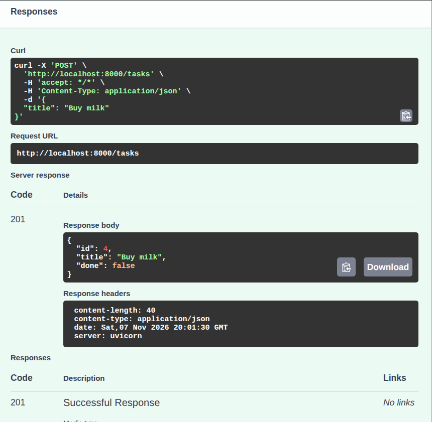

# Task API: FlyRank Internship (Week 2, Assignment A1)

A small **CRUD API** that manages a to-do list, built with **Python + FastAPI**.
Tasks live **in memory only** (no database, no files): restarting the server resets the data.

Task model: `{ "id": number, "title": string, "done": boolean }`

## Install & run

Requires Python 3.10+.

```bash
python3 -m venv venv
source venv/bin/activate          # Windows: venv\Scripts\activate
pip install -r requirements.txt
uvicorn main:app --reload
```

The server starts on `http://localhost:8000`.
Swagger UI (interactive docs): `http://localhost:8000/docs`

## Endpoints

| Method | Path | Description | Success | Errors |
|--------|------|-------------|---------|--------|
| GET | `/` | API info | 200 | |
| GET | `/health` | Health check | 200 | |
| GET | `/tasks` | List all tasks | 200 | |
| GET | `/tasks/{id}` | Get one task | 200 | 404 |
| POST | `/tasks` | Create a task (`title` required) | 201 | 400 |
| PUT | `/tasks/{id}` | Update `title` and/or `done` | 200 | 400, 404 |
| DELETE | `/tasks/{id}` | Delete a task | 204 (empty body) | 404 |

All errors return JSON: `{ "error": "message" }`.

## Example: `curl -i`

```bash
curl -i -X POST http://localhost:8000/tasks -H "Content-Type: application/json" -d '{"title":"Buy milk"}'
```

```
HTTP/1.1 201 Created
date: Sat, 07 Nov 2026 20:07:21 GMT
server: uvicorn
content-length: 40
content-type: application/json

{"id":6,"title":"Buy milk","done":false}
```

## Swagger UI




## The mortality experiment

I created a few tasks, restarted the server, and called `GET /tasks`: only the 3 original tasks were left.
The data lives in a Python list in memory, so it disappears when the process stops. That is why databases exist.